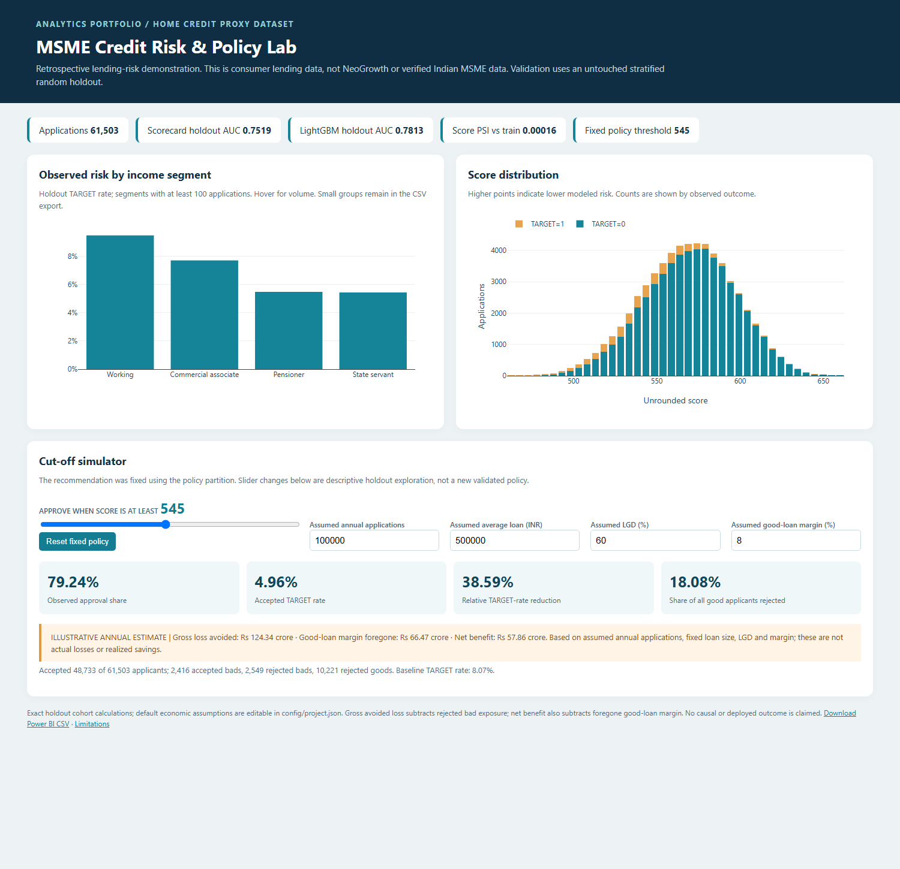

# MSME Credit Risk Scorecard and Early-Warning System

Help a lending analytics team rank repayment difficulty, compare an auditable scorecard
with a nonlinear challenger, and quantify approval trade-offs before a controlled pilot.
This executed portfolio uses **Home Credit consumer lending data as a methodological
proxy**, not NeoGrowth data or verified Indian MSME data. It is not a production model.

## Headline results: untouched stratified random holdout

| Measure | Scorecard | LightGBM |
|---|---:|---:|
| AUC | 0.7519 | 0.7813 |
| Gini | 0.5039 | 0.5626 |
| KS | 37.64% | 42.81% |
| Brier | 0.06856 | 0.06653 |

- SQL modeling table: **307,511 rows**, **168 candidate predictors** (excludes identifier and TARGET).
- Scorecard retains **20** training-selected predictors; LightGBM uses **167** eligible predictors.
- Scorecard holdout PSI: **0.00016** versus train; this random split cannot establish temporal stability.
- Fixed policy score >= **545**, selected on the separate policy partition: holdout approval **79.24%**, accepted bad rate **4.96%** versus **8.07%** baseline.
- Estimated retrospective bad-rate reduction **38.59%**, rejecting **18.08%** of observed good applicants.
- **ILLUSTRATIVE** annual gross loss avoided **Rs 124.34 crore**; net benefit after foregone good margin **Rs 57.86 crore**. See editable assumptions below.

Every quantitative result above is generated from `reports/metrics.json`. Actual code
output is saved in `reports/*_execution.txt` and `reports/headline_metrics.txt`.

## Approach and validation design

SQLite loads all required source tables. SQL collapses monthly bureau records before
joining and partial installment payments before aggregating. Day-zero cutoffs and
prior completed monthly snapshots exclude future observations. Application count
and unique IDs are asserted after joining. Raw source SHA-256 hashes are retained.

Stratified random partitions separate model training, policy/calibration, test and
holdout. There is no verified application date: **no out-of-time or pseudo-OOT claim**.
The policy partition is reserved for cut-off selection, not probability calibration.
Numeric WoE bins are trained by quantiles and adjacent monotonic pooling; missing
values get a special bin. Train-only IV, correlation and VIF checks select the
scorecard. LightGBM candidate settings use training-only cross-validation. Raw
probability calibration is evaluated without fitting a calibrator.

The points scale uses configured base score 600,
good/bad odds 50:1 and PDO
20. Points = offset - factor x log odds of TARGET=1.
Exact unrounded point additivity is checked. SHAP plots explain log-odds contributions;
they do not establish causes. Gains tables, paired AUC bootstrap intervals and
score/key-feature PSI are included.

## Business insights (descriptive full labeled portfolio)

- Working: 9.59% TARGET rate, 51.63% of full labeled volume, 1.19x portfolio risk.
- Commercial associate: 7.48% TARGET rate, 23.29% of full labeled volume, 0.93x portfolio risk.
- Pensioner: 5.39% TARGET rate, 18.00% of full labeled volume, 0.67x portfolio risk.
- State servant: 5.75% TARGET rate, 7.06% of full labeled volume, 0.71x portfolio risk.

These observed segments are descriptive; small segments need caution. The figures do
not establish causal effects and do not select features using holdout labels.



Open `dashboard/index.html` in a browser: all charts work offline. The cut-off simulator
recomputes exact holdout outcomes and illustrative economics as inputs change.
Post-hoc exploration must not replace the preselected policy without fresh validation.
`dashboard/powerbi_holdout.csv` is the Power BI import export.

## Run end to end (PowerShell, Python 3.11)

```powershell
python -m venv .venv
.\.venv\Scripts\python.exe -m pip install -r requirements.txt
# Obtain the official data first: see DATA_DOWNLOAD.md.
.\.venv\Scripts\python.exe scripts/download_data.py --check-only
.\.venv\Scripts\python.exe scripts/run_pipeline.py --stage all
.\.venv\Scripts\python.exe scripts/finalize_project.py
```

Individual stages are `sql`, `audit`, `model`, `simulation`, `deliverables`. SQL ingestion
is restartable using source hashes; feature aggregation and modeling are deterministic
rebuilds. Finalization executes notebooks, captures and checks the dashboard in installed
Chrome, renders PDFs using Poppler (`pdftoppm` must be on PATH), checks saved outputs,
and builds the ZIP. It uses headless Chrome directly, without a driver download.
The notebook series is an executed walkthrough of the artifacts; reusable full
implementation lives in `src/`, `sql/`, `early_warning/` and `dashboard/`.

## Economic assumptions (not measured outcomes)

Edit `config/project.json`: annual applications, average INR loan, LGD and margin on
good loans, plus minimum approval share. The chosen threshold maximizes illustrative
net benefit on the policy partition subject to the configured approval constraint.
Gross loss avoided = rejected bad share x assumed applications x loan size x LGD.
Net benefit subtracts rejected good share x assumed applications x loan size x good
margin. No Home Credit currency conversion, actual recovery data or realized saving
is implied. Recompute the model stage after changing assumptions to reselect policy.

## SIMULATED early warning

`early_warning/README.md` documents a seeded sales process with artificial events,
weekly seasonality, noise, declines and temporary shocks. Only applicant IDs link
to Home Credit; sales and outcomes are **SIMULATED**, independent of actual TARGET.
SIMULATED precision is **45.55%**, recall
**100.00%**, median lead time
**16 SIMULATED days** among detected events.
Built-in decline makes these method-demonstration results unsuitable as real findings.

## Deliverables and evidence

- `output/pdf/business_memo.pdf`: memo to DVP - Analytics.
- `output/pdf/interview_prep.pdf`: one-page interview sheet.
- `reports/resume_bullets.md`: measured, qualified resume claims.
- `reports/metrics.json`: machine-readable metric source of truth.
- `reports/scorecard_points.csv`, `woe_bins.csv`, `vif.csv`, `boosting_cv.csv`.
- `reports/gains_*.csv`, `calibration_*.csv`, `score_psi.json`, `key_feature_psi.json`.
- `models/`: fitted scorecard and LightGBM pipelines.
- `dist/msme_credit_risk_project.zip`: code, models, reports, dashboard and simulation;
  source data, database, environment and large processed intermediates are omitted.

## Limitations and next steps

Read **[all limitations and assumptions](reports/LIMITATIONS.md)**. Main limits are
population mismatch, withheld target horizon, random rather than temporal validation,
selection bias, unproven production feature availability, uncorrected calibration,
sensitive proxies, heuristic PSI thresholds and assumed economics. No causal policy
effect, fair-lending certification, or production readiness is claimed. Next steps
require actual MSME data, point-in-time features, temporal testing, business calibration
and independent model-risk review.

## Sources

- [Official competition](https://www.kaggle.com/competitions/home-credit-default-risk)
- Supplied `HomeCredit_columns_description.csv` (read with Windows-1252 encoding).
- [LightGBM parameters](https://lightgbm.readthedocs.io/en/stable/Parameters.html)
- [SHAP TreeExplainer](https://shap.readthedocs.io/en/latest/generated/shap.TreeExplainer.html)
- [Kaggle CLI](https://github.com/Kaggle/kaggle-cli)
